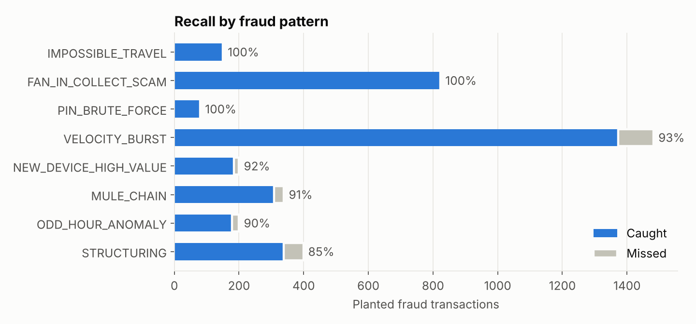
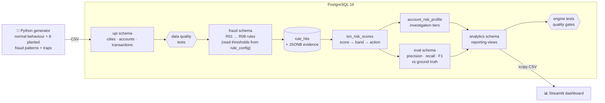
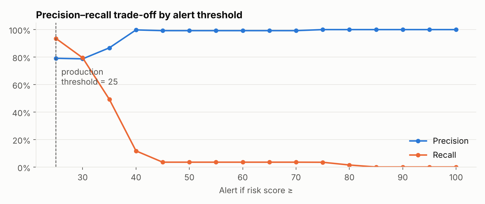
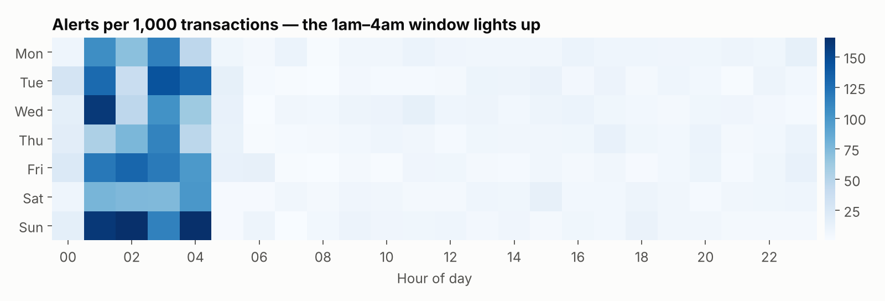

# 🛡️ UPI Fraud Detection Engine — written in pure SQL


A rule-based fraud detection engine for **Indian UPI payments**. It is built entirely in **PostgreSQL**: 8 detection rules, a risk-scoring layer, account-level investigation tiers, and an accuracy check against planted ground truth. All of it runs from one `psql` command.

> **Headline result:** across **5.89 lakh transactions** (₹54.95 Cr), the engine raised **7.4 alerts per 1,000 payments**. It caught **93.6 % of fraud transactions** (**93.7 % of the fraud value**) with **79 % precision**. It also uncovered **60 money-mule chains** through **97 mule accounts** using a recursive CTE.

<p align="center"></p>

---

## Why this project

UPI handles billions of payments a month, and fraud has kept pace with it: account takeovers, SIM swaps, fake "collect" requests, and mule accounts that launder stolen money in minutes. Banks and payment apps fight this with **rules engines** sitting next to their ML models, and those rules are mostly **SQL**.

This project rebuilds that kind of engine from scratch. It shows the advanced SQL a senior data analyst uses day to day: window frames, recursive graph traversal, LATERAL joins, statistical baselines, config-driven logic, testing, and performance tuning.

## Architecture



The ground-truth labels live in a separate `eval` schema that **no rule ever reads**. They are used only afterwards, to grade the engine honestly.

## The 8 rules

| Code | Rule | Fraud it targets | Key SQL technique | Precision | Recall |
|---|---|---|---|---:|---:|
| R01 | Velocity burst | Account takeover draining funds | `RANGE BETWEEN INTERVAL … PRECEDING` time window | 83 % | 93 % |
| R02 | Impossible travel | Stolen credentials used far away | `LAG()` + haversine distance function | 68 % | 100 % |
| R03 | Mule chain | Layering through mule accounts | **`WITH RECURSIVE`** graph walk + cycle guard | 100 % | 89 % |
| R04 | New device + high value | SIM swap / phone takeover | `ROW_NUMBER()` first-use + baseline ending `1 PRECEDING` | 67 % | 93 % |
| R05 | Structuring | Splitting amounts under ₹10,000 | `GROUP BY … HAVING` on a value band | 88 % | 85 % |
| R06 | Fan-in collect scam | New account collecting from many victims | `CROSS JOIN LATERAL` + `COUNT(DISTINCT)` | 73 % | 100 % |
| R07 | Odd-hour anomaly | 1–4 am spend far above normal | Running `AVG`/`STDDEV_SAMP` → **z-score** | 74 % | 90 % |
| R08 | PIN brute force | Guessing the UPI PIN | `COUNT(*) FILTER (…) OVER (window)` | 100 % | 100 % |

*Recall = share of the rule's own target pattern it caught. Full logic for each rule: [`docs/rule_catalog.md`](docs/rule_catalog.md).*

Every rule writes **why** it fired into a JSONB `evidence` column, so an investigator sees, for example:

```json
{"R02": {"from_city": "Hyderabad", "to_city": "Kolkata", "distance_km": 1182,
         "minutes_apart": 29.0, "implied_speed_kmph": 2445, "device_changed": true},
 "R04": {"amount": 23532.00, "prior_avg_amount": 694.29, "x_times_normal": 33.9},
 "R07": {"hour_of_day": 1, "z_score": 37.96}}
```

### The mule-chain rule (the hardest query)

```sql
WITH RECURSIVE chain AS (
    SELECT t.txn_id AS root_txn_id, t.txn_id, t.payee_account_id, t.txn_ts, t.amount,
           1 AS depth, ARRAY[t.payer_account_id, t.payee_account_id] AS account_path
    FROM upi.transactions t
    WHERE t.status = 'SUCCESS' AND t.amount >= 10000                 -- anchor
  UNION ALL
    SELECT c.root_txn_id, n.txn_id, n.payee_account_id, n.txn_ts, n.amount,
           c.depth + 1, c.account_path || n.payee_account_id
    FROM chain c
    JOIN upi.transactions n
      ON  n.payer_account_id = c.payee_account_id                     -- receiver pays onward
      AND n.txn_ts BETWEEN c.txn_ts AND c.txn_ts + INTERVAL '60 minutes'
      AND n.amount BETWEEN c.amount * 0.90 AND c.amount               -- forwards ~all of it
    WHERE c.depth < 8
      AND NOT n.payee_account_id = ANY (c.account_path)               -- cycle guard
)
SELECT * FROM chain WHERE depth >= 3;
```

(The production version in [`r03_mule_chain.sql`](sql/10_rules/r03_mule_chain.sql) reads every number above from `fraud.rule_config`. It also removes sub-chains and builds a suspected-mule-account table.)

## Results

| Metric (alert = risk score ≥ 25) | Value |
|---|---:|
| Transactions scanned | 5,88,914 |
| Alerts raised | 4,343 (7.37 per 1,000) |
| Precision | **79.1 %** |
| Recall | **93.6 %** |
| F1 score | 0.858 |
| False-positive rate on genuine payments | 0.15 % |
| Fraud value caught | **₹4.40 Cr of ₹4.69 Cr (93.7 %)** |
| Mule chains / mule accounts found | 60 / 97 |
| Full engine runtime (8 rules + scoring + eval) | ≈ 20 s on a laptop |

**The misses and false alarms are deliberate.** The generator plants *evasive* fraud that stays just under the thresholds: mule hops 70–180 minutes apart, slow account takeovers, structuring spread over two days. It also plants *genuine traps*: a new phone used to pay rent, a mall shopping spree, a student collecting trip money from 12 friends, a late-night hospital payment. A detector that scored 100 % on everything would be testing nothing.

<p align="center"></p>

Most fraud trips exactly one rule, so recall collapses above a score of 30. That is why the production threshold sits at the MEDIUM band (25), with higher bands deciding *how hard* to act: step-up authentication, hold for review, or block.

<p align="center"></p>

### A tuning experiment, done in SQL

R02 (impossible travel) began with **16 % precision**, because city geolocation is noisy. [`01_rule_tuning_r02.sql`](sql/60_analyst_toolkit/01_rule_tuning_r02.sql) A/B-tests adding a "device must also change" condition:

| Version | Alerts | False positives | Precision | Recall |
|---|---:|---:|---:|---:|
| A: location jump only | 955 | 803 | 15.9 % | 100 % |
| **B: location jump + new device** | **223** | **71** | **68.2 %** | **100 %** |

**91 % of false alarms removed, zero fraud lost.** The change is one JSONB value in `fraud.rule_config`, with no code edit.

### Indexes matter

[`03_query_performance.sql`](sql/60_analyst_toolkit/03_query_performance.sql) runs R06's core lookup with and without the `(payee_account_id, txn_ts)` index inside a rolled-back transaction: **0.09 ms (index scan) vs 8.9 ms (bitmap heap scan), about 100× faster**. That lookup runs once for every inbound payment to a new account.

## SQL skills demonstrated

- **Window functions:** time-based `RANGE` frames, `ROWS … 1 PRECEDING` baselines, `LAG`, `ROW_NUMBER`, `RANK`, `DENSE_RANK`, `FILTER` inside window aggregates
- **Recursive CTEs:** money-flow graph traversal, path arrays, cycle detection
- **`LATERAL` joins:** a workaround for `COUNT(DISTINCT)` not being allowed as a window function
- **Statistics in SQL:** running mean / standard deviation → z-scores
- **Config-driven design:** thresholds in JSONB, read by `STABLE` SQL functions
- **Custom functions:** `IMMUTABLE` haversine distance, logging function
- **JSONB:** evidence building (`jsonb_build_object`, `jsonb_object_agg`), `jsonb_set` for tuning
- **Data engineering:** layered schemas, bulk `\copy`, FKs and indexes added after load, partial and BRIN indexes, `ANALYZE`
- **Testing:** `DO` blocks with `ASSERT` for data quality and quality gates, run in CI on every push
- **Evaluation:** confusion matrix, precision / recall / F1, threshold curve via `generate_series`
- **psql scripting:** `\i`, `\gset`, `\if`, `-v` variables

## Quick start

You need **PostgreSQL 16** (or Docker) and **Python 3.10+**.

```bash
git clone https://github.com/Dharmeshkumar2327/upi-fraud-detection-sql.git
cd upi-fraud-detection-sql
pip install -r requirements.txt
```

**Option A: local PostgreSQL**

```bash
./scripts/run_pipeline.sh            # generates ~5.9 lakh txns and builds everything
./scripts/run_pipeline.sh --small    # ~1.2 lakh txns, under 10 seconds
```

On Windows (PowerShell): `.\scripts\run_pipeline.ps1` (or `-Small`).
Set `PGUSER`, `PGPASSWORD`, `PGHOST` and `PGPORT` if yours differ from `postgres@localhost:5432`.

**Option B: Docker (no local PostgreSQL needed)**

```bash
make docker-run        # starts postgres:16, generates data, runs the engine inside the container
```

**Dashboard**

```bash
streamlit run dashboard/app.py
```

The dashboard reads the small CSVs in `dashboard/data/`, which are committed to the repo. So it also deploys directly to **Streamlit Community Cloud** (main file: `dashboard/app.py`) without a database.

**Other useful commands**

```bash
make rules         # re-run rules after editing fraud.rule_config (skips the data reload)
make tune          # R02 A/B tuning experiment
make investigate   # one-page case file for the riskiest account (ACCOUNT=<id> for another)
make perf          # EXPLAIN ANALYZE with vs without index
```

Tuning a rule is one statement:

```sql
UPDATE fraud.rule_config SET params = jsonb_set(params, '{min_txns}', '8') WHERE rule_code = 'R01';
```

## Project structure

```
upi-fraud-detection-sql/
├── data_generator/generate_data.py      # synthetic UPI data + planted fraud + traps
├── sql/
│   ├── run_all.sql                      # orchestrates everything below
│   ├── 00_setup/                        # schemas, load, indexes, functions, rule config
│   ├── 10_rules/                        # r01 … r08 - one file per rule
│   ├── 20_scoring/                      # transaction scores, account risk profiles
│   ├── 30_evaluation/                   # precision / recall / F1 vs ground truth
│   ├── 40_analytics/                    # reporting views
│   ├── 50_export/                       # CSV export for the dashboard
│   ├── 60_analyst_toolkit/              # tuning experiment, case file, EXPLAIN demo
│   └── 90_tests/                        # data quality + engine regression tests
├── dashboard/app.py                     # Streamlit dashboard (5 tabs)
├── dashboard/data/                      # exported aggregates (committed)
├── docs/                                # rule catalogue, data dictionary, chart images
├── scripts/                             # run_pipeline.sh / .ps1, README chart renderer
├── .github/workflows/ci.yml             # runs the whole engine + tests on every push
├── docker-compose.yml · Makefile · requirements.txt
```

## Dashboard

Five tabs: **Overview** (KPIs, daily alerts, risk bands, recall by pattern) · **Rule performance** (scorecard, precision vs recall, threshold curve, rule overlap) · **Hotspots** (day × hour heatmap, cities, channels) · **Mule network** (trace any chain as a Sankey money-flow diagram) · **Investigator** (filterable alert queue with JSON evidence, top risky accounts).

## Limitations & next steps

- The data is synthetic. Fraud shapes are modelled on publicly described UPI scams, not on any real bank's data.
- Rules run in batch. A next step is streaming the same logic (Kafka + Flink SQL, or Postgres triggers for R01 and R08).
- Partition `upi.transactions` by month for multi-year volumes.
- Feed `rule_hits` into an ML model as features, and compare it with the rules.
- Add a feedback loop: analyst decisions → `eval` table → automatic threshold suggestions.

## Disclaimer

All accounts, names, VPAs and transactions are **randomly generated**. Any resemblance to real people or accounts is coincidental. This is a portfolio and learning project, not production fraud advice.

---

**Dharmesh Kumar** · Senior Tech Instructor & Data Analyst · [GitHub](https://github.com/Dharmeshkumar2327) · [LinkedIn](https://www.linkedin.com/in/dharmesh-kumar-293a89235)
