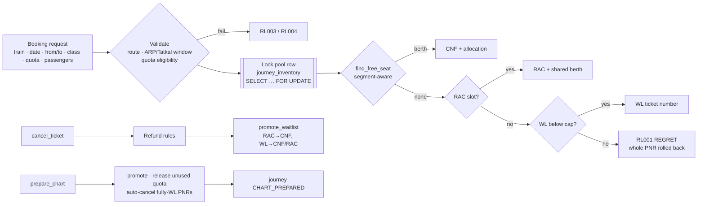
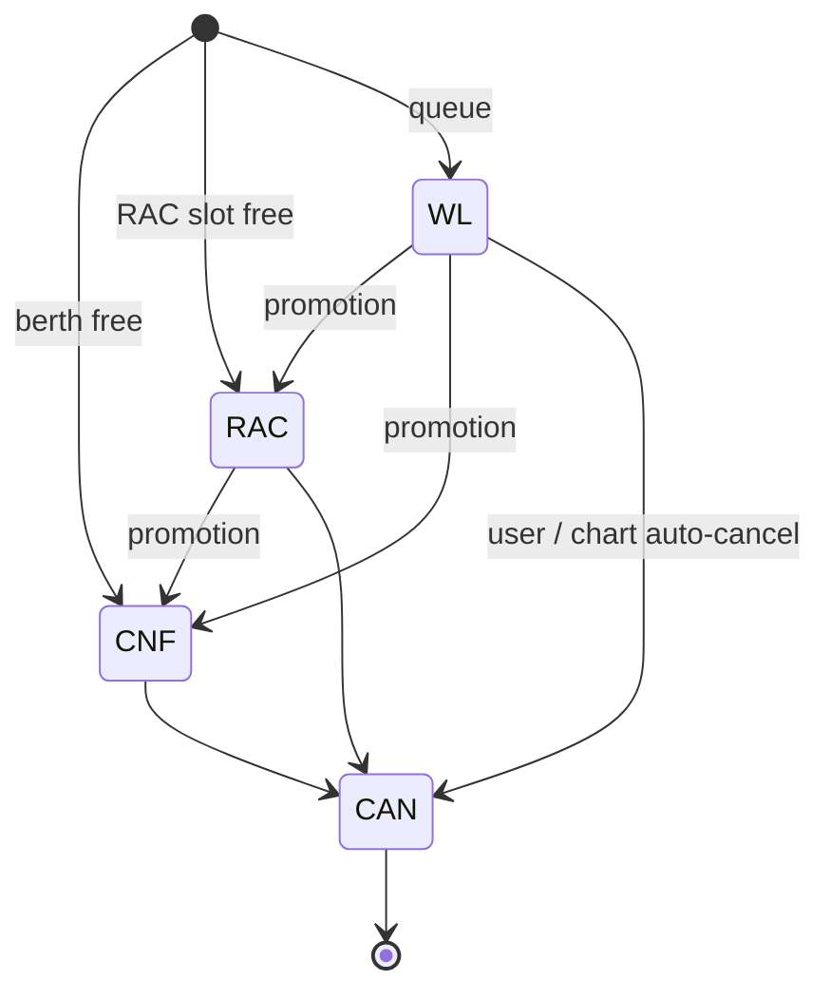
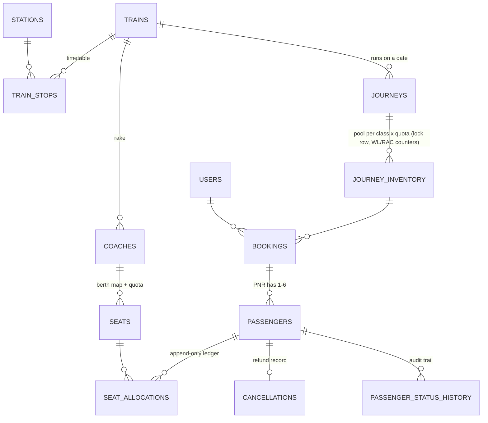

# 🚆 RailReserve: an Indian Railways Booking & Waitlist Engine in pure SQL


This is a working reservation system for an IRCTC-style booking flow, built entirely inside PostgreSQL. It handles **segment-wise seat allocation**, **RAC berth sharing**, **waitlist queues with automatic promotion**, **Tatkal windows**, **quota rules**, **refund rules** and **chart preparation**. The database guarantees that a berth can never be double-booked, even under concurrent load.

A built-in simulator replays **60,448 booking attempts** from **4,000 users** over 60 days of traffic (ARP-opening rushes, Tatkal stampedes, cancellations). The replay drives the real engine and produces a realistic dataset. Then **26 analytical queries** turn that data into operational and revenue insights.

> No application server, ORM or Python. All of it is tables, constraints, PL/pgSQL functions, triggers, views and SQL.

---

## 📌 Highlights

| | |
|---|---|
| **Network** | 62 stations · 10 trains · 87 timetabled stops · 7 classes (1A, 2A, 3A, SL, CC, EC, 2S) · 4 quotas (GN, TQ, LD, SS) |
| **Inventory** | 7,487 berths/seats with auto-generated layouts (LB/MB/UB/SL/SU, WS/MS/AS) across 134 train runs |
| **Dataset** | 59,706 PNRs · 132,621 passengers · 126,568 seat allocations · 158,204 audit events · ₹20 crore gross fare |
| **Guarantee** | `EXCLUDE USING gist` constraint means **0 overlapping allocations**, proven by a 64-client `pgbench` race |
| **Engine** | `book_ticket`, `cancel_ticket`, `promote_waitlist`, `prepare_chart`, `cancel_journey`, `get_availability`, `search_trains` |
| **Analytics** | 26 queries plus a **waitlist-confirmation predictor** (materialized view) |

---

## 🧠 The core idea: berths are sold per segment, not per train

A train is a chain of stops. A passenger from stop 3 to stop 7 occupies the half-open range **`[3,7)`**, which covers segments 3, 4, 5 and 6. Another passenger can use the *same berth* for `[7,10)`, or `[1,3)`.

```
Stops:        SBC ── ATP ── GTL ── RC ── WADI ── SUR ── ... ── NDLS
Segments:        1      2      3     4       5
Berth B1/23:  [====== Asha: SBC→RC ======)[==== Ravi: RC→NDLS ====...)
```

PostgreSQL range types make this a first-class constraint, not application logic:

```sql
CONSTRAINT no_double_booking EXCLUDE USING gist (
    journey_id WITH =,
    seat_id    WITH =,
    slot       WITH =,      -- RAC berths have 2 slots (two passengers share a side-lower)
    seg_range  WITH &&      -- && = ranges overlap
) WHERE (is_active)
```

The seat finder also **packs** journeys. It prefers berths that are already sold on an adjacent segment (`-|-` adjacency operator), which keeps fully empty berths free for end-to-end travellers and reduces unsellable fragments. Query **Q05** measures the fragments that remain.

---

## 🏗️ Architecture



### Passenger state machine (enforced by trigger)



Any other transition (for example `CAN → CNF` or `CNF → WL`) raises an exception, whoever tries it.

### Data model



---

## 🔐 Correctness under concurrency: three layers

1. **Pessimistic lock per pool.** `book_ticket` locks a single `journey_inventory` row (journey × class × quota) with `FOR UPDATE`. Writers on the *same* pool queue up. Other trains, classes and quotas keep running in parallel. Chart preparation locks every pool of a journey in a fixed order, which avoids deadlocks.
2. **Exclusion constraint.** Even if code bypasses the engine, the database rejects overlapping allocations (`SQLSTATE 23P01`).
3. **Ledger plus state-machine triggers.** Allocations can only be *released*, never edited, deleted or revived. Booking journey fields are immutable. Status changes follow the state machine above.

**Race test.** `tests/concurrency_test.sh` sends 64 simultaneous `pgbench` clients at a train with 10 berths, 2 RAC places and a 20-WL cap:

```
 outcome | count
---------+-------
 CNF     |    10     <- 10 different berths
 GNWL    |    20     <- WL numbers exactly 1..20, no gaps or duplicates
 RAC     |     2
 REGRET  |    32
NOTICE:  PASS  concurrency: no double booking, no lost or duplicate WL numbers
```

---

## 📜 Business rules modelled

| Rule | Implementation |
|---|---|
| Advance Reservation Period | 60 days (excl. journey day), opens 08:00 (`rules` table) |
| Tatkal | Opens 10:00 (AC) / 11:00 (non-AC) one day before the journey date from origin. Max 4 passengers, no RAC, Tatkal WL only |
| Allocation order | **CNF → RAC → WL → REGRET**, all-or-nothing per PNR, optional *book only if confirmed* |
| Berth preference | Same coach as co-passengers, then requested berth, then **lower berth for men 60+ / women 45+**, then segment packing |
| Quotas | GN, TQ, LD (women, boys < 12), SS (senior / lower berth, max 2) |
| Fare | base (km × class rate × train-type multiplier) + reservation + superfast + Tatkal premium (clamped) + catering + 5% GST on AC, rounded up to ₹5 |
| Cancellation (CNF) | > 48h: flat charge per class · 48–12h: 25% · 12–4h: 50% · < 4h or after chart: no refund · Tatkal CNF: no refund |
| Cancellation (RAC/WL) | Fare minus ₹60 clerkage, up to 30 min before departure |
| Promotion | On every cancellation: RAC queue first, then WL (to CNF, else RAC), in ticket order, segment-aware |
| Chart (4h before departure) | Final promotion; unused **Tatkal / Ladies / Senior berths released** to GN then TQ queues; fully-WL PNRs **auto-cancelled** (fare − clerkage); partly confirmed PNRs keep WL passengers travelling with their party; journey closed |
| Train cancelled | Full refund to everyone |
| PNR | 10 digits, zone-group prefix plus sequence scrambled by a multiplicative permutation mod 10⁹ (unique, not guessable) |

Custom SQLSTATEs let callers branch on why a booking failed: `RL001` REGRET · `RL002` NOT_CONFIRMED · `RL003` WINDOW_CLOSED · `RL004` INVALID.

---

## 🚀 Quick start

### Option A: Docker
```bash
git clone https://github.com/Dharmeshkumar2327/rail-booking-engine.git
cd rail-booking-engine
docker compose up -d
docker compose exec -u postgres -w /work db ./run_all.sh     # ~10 min (replays 68k events)
docker compose exec -u postgres db psql -d railway
```

### Option B: local PostgreSQL 14+
```bash
export PGHOST=localhost PGUSER=postgres        # adjust to your setup
./run_all.sh                                   # creates DB "railway", builds, simulates, runs reports + tests
./tests/concurrency_test.sh                    # optional: 64-client race test
psql -d railway -f sql/07_demo.sql             # guided tour (rolled back, replayable)
```

`run_all.sh` runs these steps:

| Step | File | What it does |
|---|---|---|
| 1 | `00_setup.sql` | Fresh `rail` schema, `btree_gist`, IST timezone |
| 2 | `01_schema.sql` | 16 tables, enums, CHECK/FK/EXCLUDE constraints, indexes |
| 3 | `02_reference_data.sql` | Rules, classes, quotas, 62 stations, 10 trains, timetables, rakes, seat maps with quota earmarking |
| 4 | `03_engine.sql` | The engine (PL/pgSQL) |
| 5 | `04_triggers_views.sql` | State machine, audit, immutability triggers; PNR, queue and utilisation views |
| 6 | `05_simulate.sql` | 4,000 users, demand model, event-queue replay through the engine |
| 7 | `06_analytics.sql` | 26 reports, written to `docs/analytics_output.txt` |
| 8 | `tests/test_engine.sql` | 50 assertions, all inside a rolled-back transaction |

> ⏱️ **Business clock.** The dataset's "today" is **2026-11-15 23:00 IST**, set as a database default with `rail.now`. Week-1 trains (9–15 Nov) are charted and departed. Week-2 trains are live with open waitlists. You can time-travel in any session:
> `SET rail.now = '2026-11-18 10:00+05:30';`

---

## 🎮 Try it

```sql
SET search_path = rail;

-- Trains between two stations, every class, live availability
SELECT train_no, train_name, departs, class_code, fare, availability
FROM search_trains('BPL', 'NDLS', '2026-11-20');
--  12627 | Karnataka Express  | 20 Nov 23:20 | 3A | 1085 | AVAILABLE-0012
--  12621 | Tamil Nadu Express | 20 Nov 23:55 | 3A | 1080 | RAC 28

-- Book a family
SELECT * FROM book_ticket(42, '12627', '2026-11-20', 'BPL', 'NDLS', 'SL', 'GN',
  '[{"name":"Dharmesh Kumar","age":34,"gender":"M","berth_pref":"UB"},
    {"name":"Sita Devi","age":63,"gender":"F"}]');

-- PNR enquiry: status at booking vs now
SELECT * FROM v_pnr_status WHERE pnr = '<pnr>';

-- Cancel one passenger; the queue promotes itself
SELECT * FROM cancel_ticket('<pnr>', ARRAY[1]::smallint[]);

-- Will WL 25 confirm?
SELECT predict_confirmation('12951', '3A', 25);
```

`sql/07_demo.sql` runs the full story (search → book → PNR → someone cancels → RAC/WL queue moves → audit trail → prediction) and rolls it back afterwards.

Excerpt from [`docs/demo_output.txt`](docs/demo_output.txt). A confirmed couple cancels on 12627 3A, and the RAC queue moves automatically:

```
--- ... and the queue moves on its own: RAC -> CNF, WL -> RAC
    pnr     |  full_name   | booking_status | status_before |  status_now
------------+--------------+----------------+---------------+--------------
 4091911315 | Usha Verma   | RAC/16         | RAC 1         | CNF/B3/48/SU
 4091911315 | Faisal Rao   | RAC/17         | RAC 2         | CNF/B3/57/LB
 4093146679 | Ishita Patel | RAC/18         | RAC 3         | RAC 1
 4093146679 | Pranav Dubey | RAC/19         | RAC 4         | RAC 2
```

---

## 📊 Analytics (`sql/06_analytics.sql`)

| # | Question | SQL technique |
|---|---|---|
| Q01 | Status mix per train run | `FILTER` pivot |
| Q02 | Berth-km utilisation by train × class | view + `RANK()` |
| Q03 | Busiest segment of each train | `generate_series` segment explosion + `ROW_NUMBER()` |
| Q04 | Occupancy profile along a route | conditional aggregation |
| Q05 | **Seat fragmentation**, free 1-segment holes | **gaps & islands** with `LAG()` over ranges |
| Q06 | Quota berths released at chart | audit-trail join |
| Q07 | **Will my waitlist confirm?** by WL bucket | `width_bucket`, `EXISTS` |
| Q08 | How deep into the WL did confirmations reach | `FILTER` aggregates |
| Q09 | Time-to-confirm (median, p90) | `PERCENTILE_CONT` on intervals |
| Q10 | Most common status paths (`WL > RAC > CNF`) | ordered `STRING_AGG` |
| Q11 | Split families (mixed status / coaches) | `COUNT(DISTINCT)` |
| Q12 | Live WL passengers with predicted chance | materialized view + SQL function |
| Q13 | Lost demand (REGRET) and revenue at risk | rejected-attempt log × fare function |
| Q14 | Top O-D pairs, net of refunds | `LEFT JOIN` refunds |
| Q15 | Booking lead time by quota | bucketing + window share |
| Q16 | Tatkal sell-out speed | time-to-first-WL |
| Q17 | Daily revenue, running total, 7-day MA, WoW | window frames, `LAG(…, 7)` |
| Q18 | Class P&L (gross, refunds, cancellation income) | window share of total |
| Q19 | When people cancel and what it costs them | refund rule buckets |
| Q20 | Weekday demand index | ratio to window average |
| Q21 | **Tatkal power users / bot-like accounts** | **z-score** with `STDDEV_POP() OVER ()` |
| Q22 | Customer value tiers | `NTILE(4)` |
| Q23 | Berth-preference and senior-lower-berth fulfilment | conditional ratios |
| Q24 | Channel mix | window share |
| Q25–26 | **Integrity audits** (overlaps, orphan states, fare totals) | self-join on `&&` |

### Sample findings from the simulated data
- **Tatkal disappears in about 3 minutes.** On the busiest trains the Tatkal quota sells out 2.8–3.9 minutes after the window opens (Q16).
- **Waitlist depth decides your trip.** Passengers booked at GNWL 1–19 had a **54%** chance of boarding (CNF or RAC). At GNWL 40–59 that falls to **14%**, and above WL 140 it was **0%** (Q07).
- **Bot detection with one window function.** A z-score on "Tatkal bookings in the first 5 minutes" flags **exactly the 15 agent-like accounts** planted by the simulator (z between 11 and 19). No genuine user scores above 0.7 (Q21).
- **3A is the cash cow.** It brings **48%** of net revenue. Cancellation charges added **₹35.3 lakh** of income across all classes (Q18).
- **Seniors really get lower berths.** 70–87% of men 60+ and women 45+ sit on a lower berth, against 19–39% of everyone else (Q23).
- **Long routes fragment berths.** The 14-stop Karnataka Express leaves the most unsellable one-segment holes (403 across 7 runs), even with packing (Q05).
- **Lost demand has a price.** REGRET and unconfirmed requests on 12951 Mumbai Rajdhani 3A alone represent **₹4.6 lakh** of fare that could have been earned (Q13).

The full output of every query is in [`docs/analytics_output.txt`](docs/analytics_output.txt).

---

## ✅ Tests

`tests/test_engine.sql` builds a 3-stop test train with **4 berths** (2 GN, 1 RAC side-lower, 1 Tatkal) and walks it through every rule. It runs inside one transaction and rolls back:

- segment re-use (NDLS→AGC + AGC→BPL share one berth), CNF → RAC/1 → RAC/2 → GNWL/1 → GNWL/2
- confirm-only bookings are atomic (no partial rows), REGRET at the WL cap
- cancellation refunds (flat, RAC clerkage, Tatkal zero), cascade promotion, segment-aware RAC fit
- Tatkal window timing, Ladies quota, wrong direction, non-running date
- `EXCLUDE` violation, illegal state transition, immutable booking, append-only ledger
- chart: Tatkal berth released to RAC, RAC berth printed on chart, journey locked, WL auto-cancel with clerkage, train cancellation full refund
- global integrity checks on the full dataset

```
NOTICE:  PASS  P2 AGC-BPL re-uses the SAME berth (segment packing)
NOTICE:  PASS  WL/1 (P6) promoted into the freed RAC slot
NOTICE:  PASS  AGC-BPL: same train still offers RAC (slot free on that segment)
NOTICE:  PASS  EXCLUDE constraint blocks an overlapping allocation  (SQLSTATE 23P01)
NOTICE:  PASS  chart releases unused Tatkal berth to RAC passenger P6
...
All engine tests passed.
```

---

## 📁 Project structure

```
rail-booking-engine/
├── README.md
├── run_all.sh                 # one-command build: schema → data → simulation → reports → tests
├── docker-compose.yml
├── sql/
│   ├── 00_setup.sql
│   ├── 01_schema.sql
│   ├── 02_reference_data.sql
│   ├── 03_engine.sql          # booking / cancellation / promotion / chart / availability / search
│   ├── 04_triggers_views.sql
│   ├── 05_simulate.sql        # demand model + time-ordered event replay
│   ├── 06_analytics.sql       # 26 queries + WL predictor
│   └── 07_demo.sql            # guided, rolled-back tour
├── tests/
│   ├── test_engine.sql        # 50 scenario assertions
│   ├── concurrency_test.sh    # 64-client pgbench race
│   ├── race_setup.sql · race_book.sql · race_verify.sql
└── docs/
    ├── analytics_output.txt   # output of every analytics query
    └── demo_output.txt        # output of the guided tour
```

---

## 🛠️ Skills demonstrated

- **Data modelling:** normalized OLTP schema, enums, composite FKs, partial unique indexes, range types
- **Integrity:** `EXCLUDE USING gist`, CHECK constraints, trigger-enforced state machine, append-only ledger
- **Concurrency:** `SELECT … FOR UPDATE` pool locks, deadlock-safe lock ordering, `pgbench` race verification
- **PL/pgSQL:** set-returning functions, custom SQLSTATEs, subtransactions, procedures with `COMMIT`, an injectable clock
- **Performance:** anti-join seat search instead of per-row index probes (~20× faster), memoised failed ranges in promotion, `ANALYZE` during bulk load
- **Analytics:** window functions, gaps & islands, percentiles, z-scores, NTILE, materialized views
- **Simulation:** reproducible demand model and event-sourced replay through the production code path

## 🧭 Simplifications and roadmap

These are known simplifications. They're listed here openly, and each one is a possible next step:

- Single chart at origin (IR also prepares remote and second charts); no pooled quota or remote-location quota
- No child fares, concessions or berth-less child tickets; no vacant-berth current booking after chart
- WL is per pool, and passengers whose segment doesn't fit freed capacity are skipped, not reserved
- Next: partition `seat_allocations` by journey date (PG17 supports exclusion constraints on partitions), a REST layer via PostgREST, a Power BI / Streamlit dashboard on the analytics views

---

### Disclaimer
This is an educational portfolio project. It is **not affiliated with Indian Railways or IRCTC**. Train names, timetables, distances, fares and rules are illustrative approximations, and all users and passengers are synthetic.

### Author
**Dharmesh Kumar**, Senior Tech Instructor & Data Analyst
[GitHub](https://github.com/Dharmeshkumar2327) · [LinkedIn](https://www.linkedin.com/in/dharmesh-kumar-293a89235)

⭐ If you found this useful, star the repo!
