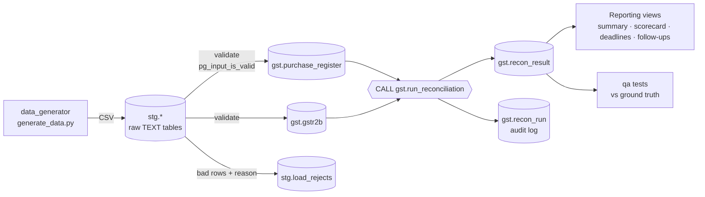

<div align="center">

# 🧾 GST Reconciliation Engine
### GSTR-2B vs Purchase Register — built entirely in PostgreSQL

**A multi-pass SQL matching engine that reconciles a company's purchase books against GSTR-2B, finds every rupee of Input Tax Credit (ITC) at risk, and tells the finance team exactly what to do about it.**


**Author: [Dharmesh Kumar](https://www.linkedin.com/in/dharmesh-kumar-293a89235)** · Senior Tech Instructor & Data Analyst · [GitHub](https://github.com/Dharmeshkumar2327)

</div>

---

## 📌 The business problem

Under India's GST, a buyer can claim Input Tax Credit **only** for invoices that appear in its **GSTR-2B**, the auto-drafted statement built from what its suppliers report in their GSTR-1 (Section 16(2)(aa), CGST Act). Every month, finance teams must reconcile thousands of purchase-register entries against GSTR-2B, and the two **never** match cleanly:

| What goes wrong in real life | Example |
|---|---|
| Invoice numbers typed differently | `INV/25-26/0012` vs `inv-25-26-12` |
| Typos in invoice numbers | `SB/327` vs `SB/237` |
| Wrong supplier GSTIN in books | one character off, checksum fails |
| Supplier filed late | booked in April, appears in May's 2B |
| Supplier never filed | ITC claimed but not in 2B → **at risk** |
| Supplier reported wrong value | ₹1,00,000 in books, ₹80,000 in 2B |
| Wrong tax head | IGST in books, CGST+SGST in 2B (place-of-supply error) |
| Invoice never booked | ITC sitting unclaimed in 2B |
| Same bill booked twice | ITC claimed twice → must reverse |
| Credit note not booked | ITC must be reversed |
| ITC blocked by 2B | 2B marks the invoice "ITC not available" |

Excel VLOOKUPs break on all of these. This project solves them **with SQL alone**.

---

## 🏆 Results (FY 2025-26, synthetic data)

| Metric | Value |
|---|---|
| Purchase-register records | **4,762** (+10 junk rows rejected at load) |
| GSTR-2B records | **4,720** from 120 suppliers |
| Engine runtime | **~0.4 seconds** for the full year |
| Auto-matched (incl. fuzzy & GSTIN fix) | **85.7 %** of records |
| ITC at risk identified | **₹20.18 lakh** |
| Unclaimed ITC found | **₹12.95 lakh** (Section 16(4) deadline: 30-Nov-2026) |
| ITC to be reversed (duplicates, credit notes) | **₹4.63 lakh** |
| **Accuracy vs planted ground truth** | **100 % (9,482 / 9,482 records)** |
| Pareto insight | **32 of 82** problem suppliers cause **80 %** of the risk |

> Every mismatch in the data was **planted deliberately** by the generator and labelled. The test suite grades the engine against that answer key, so the accuracy figure is measured, not claimed.

<details>
<summary><b>Reconciliation summary output</b> (click to expand)</summary>

```
 status_group |       match_status       | records | pct_records | itc_at_risk | itc_unclaimed | itc_reversal
--------------+--------------------------+---------+-------------+-------------+---------------+--------------
 MATCHED      | MATCHED                  |    3664 |       74.55 |        0.00 |          0.00 |         0.00
 MATCHED      | MATCHED_TOLERANCE        |     184 |        3.74 |        0.00 |          0.00 |         0.00
 MATCHED      | MATCHED_DATE_DIFF        |     162 |        3.30 |        0.00 |          0.00 |         0.00
 MATCHED      | MATCHED_FUZZY_INVNO      |     133 |        2.71 |        0.00 |          0.00 |         0.00
 MATCHED      | MATCHED_GSTIN_CORRECTION |      68 |        1.38 |        0.00 |          0.00 |         0.00
 TIMING       | MATCHED_CROSS_PERIOD     |     171 |        3.48 |        0.00 |          0.00 |         0.00
 MISMATCH     | MISMATCH_VALUE           |     103 |        2.10 |   107124.04 |      70586.00 |         0.00
 MISMATCH     | MISMATCH_TAX_HEAD        |      47 |        0.96 |   396524.29 |          0.00 |         0.00
 MISSING      | MISSING_IN_BOOKS         |     123 |        2.50 |        0.00 |    1224578.10 |         0.00
 MISSING      | CREDIT_NOTE_NOT_BOOKED   |      30 |        0.61 |        0.00 |          0.00 |     66768.77
 MISSING      | MISSING_IN_2B            |     150 |        3.05 |  1251385.28 |          0.00 |         0.00
 COMPLIANCE   | DUPLICATE_IN_BOOKS       |      45 |        0.92 |        0.00 |          0.00 |    396069.24
 COMPLIANCE   | ITC_INELIGIBLE           |      35 |        0.71 |   262961.14 |          0.00 |         0.00
 TOTAL        |                          |    4915 |      100.00 |  2017994.75 |    1295164.10 |    462838.01
```
Subtotal rows are omitted here; see [`docs/sample_output.md`](docs/sample_output.md) for the full output.
</details>

---

## 🏗️ Architecture



### The matching engine (`sql/04_matching_engine.sql`)

A single stored procedure runs **five passes**. Each pass only sees records that earlier passes left unmatched, so strict rules run first and looser rules only handle what's left.

| Pass | Rule | Catches |
|---|---|---|
| **P0 Duplicate** | same GSTIN + normalised invoice no. booked twice in books | double ITC claims |
| **P1 Exact key** | GSTIN + normalised invoice no. + document class; the pair is then *classified* by comparing value, tax head, date and period | exact, rounding, date typo, late filing, value mismatch, wrong tax head |
| **P2 Fuzzy invoice no.** | same GSTIN, **Levenshtein ≤ 2**, value within ₹10, date within ±3 days | invoice-number typos |
| **P3 GSTIN fix** | same invoice no. + value, **GSTIN Levenshtein ≤ 2** | GSTIN typos (with checksum diagnosis) |
| **P4 Leftovers** | no counterpart found | missing in 2B / missing in books / credit note not booked |
| **POST** | paired record whose 2B row says *ITC not available* | ineligible ITC |
| **VALUATION** | one `UPDATE` turns each status into rupees | at-risk / unclaimed / to-reverse |

**One-to-one guarantee.** Every pass uses *mutual best match*: a pair is accepted only when each record ranks the other as its best candidate (two `ROW_NUMBER()` windows, one partitioned by each side). Two unique partial indexes on `recon_result` make double-matching physically impossible.

**All tolerances live in `gst.recon_config`**, and every run stores a JSON snapshot of the settings it used, so results are fully auditable.

---

## 🧠 SQL concepts demonstrated

| Concept | Where |
|---|---|
| Stored procedure (PL/pgSQL) with `INOUT` param, temp working sets, `GET DIAGNOSTICS`, JSONB run log | `04_matching_engine.sql` |
| Window functions: `ROW_NUMBER`, `FIRST_VALUE`, `LAG`, `NTILE`, `DENSE_RANK`, running `SUM`, `RANGE` frames with intervals | engine, reports, analytics |
| Mutual-best-match pairing (two-sided ranking) | engine passes P1–P3 |
| Fuzzy matching: `levenshtein` (fuzzystrmatch) and trigram `similarity` (pg_trgm) + GIN trigram indexes | P2, P3 |
| `IMMUTABLE` SQL functions backing **generated columns** | `01_functions.sql`, `02_schema.sql` |
| GSTIN **Luhn mod-36 checksum** written in pure SQL | `fn_gstin_checksum` |
| Regex normalisation (`regexp_replace` with back-references) | `fn_normalize_invoice_no` |
| **Data-modifying CTEs**: validate, reject and load in one statement | `03_load.sql` |
| `pg_input_is_valid()` (PostgreSQL 16) for error-free cast checks | `03_load.sql` |
| `ROLLUP`, `GROUPING SETS`, `grouping()` | summary view, Q2 |
| Conditional aggregation with `FILTER` (pivot) | Q1, scorecard |
| Gaps-and-islands | Q3 missing voucher numbers |
| `LATERAL` joins (top-N per group) | Q6 |
| Ordered-set aggregates (`percentile_cont`) | Q7 |
| Statistical test in SQL (Benford's law, chi-square) | Q4 |
| Pareto / cumulative share analysis | Q8 |
| Constraints as business rules (`CHECK`, partial unique indexes, single-row table) | `02_schema.sql` |
| Self-grading test harness that raises exceptions | `07_tests.sql` |

---

## 📊 Reporting layer (`sql/05_reports.sql`)

| View | Answers |
|---|---|
| `gst.v_recon_summary` | How much ITC is matched, at risk, unclaimed, to be reversed? |
| `gst.v_recon_detail` | Every record, side by side, with the recommended action |
| `gst.v_monthly_itc_bridge` | Month-wise ITC in books vs 2B, with a cumulative gap |
| `gst.v_vendor_scorecard` | Which suppliers are unreliable? (0–100 score, grade A–D, risk quartile) |
| `gst.v_vendor_followup` | **A ready-to-send message per supplier** listing the invoices to fix |
| `gst.v_itc_deadline_tracker` | Section 16(4) countdown and ageing buckets for at-risk ITC |
| `gst.v_unclaimed_itc` | ITC available in 2B that was never booked, largest first |

Example: an auto-generated supplier follow-up from `gst.v_vendor_followup`:

```
Dear Tunga Steel Corporation,

Our GSTR-2B reconciliation shows 23 invoice(s) where your GSTR-1 does not match
our records, affecting input tax credit of Rs 1,87,528.48. Please file / amend
GSTR-1 for the items below at the earliest.

- 0076/25-26 dated 05-May-2025
- 0080/25-26 dated 10-May-2025
...
```

## 🔍 Advanced analytics (`sql/06_advanced_analytics.sql`)

| # | Query | Finding on this data |
|---|---|---|
| Q1 | Month × status pivot | Match rate is stable at 83–90 % every month |
| Q2 | ITC at risk by state and quarter (`GROUPING SETS`) | Karnataka suppliers hold ₹8.97 lakh of the ₹20.18 lakh at risk |
| Q3 | Missing voucher numbers (gaps-and-islands) | 16 deleted vouchers found, all planted |
| Q4 | Benford's-law test on invoice values | χ² = 4.22 < 15.51, so values look natural |
| Q5 | Suppliers getting worse (rolling 3-month rate + `LAG`) | 5 suppliers deteriorated by 15+ points |
| Q6 | Largest open item per risky supplier (`LATERAL`) | A single ₹1.21 lakh tax-head error drives one vendor's risk |
| Q7 | Filing-delay percentiles by grade | Grade-D suppliers' P90 delay is 21 days |
| Q8 | Pareto of ITC at risk | 32 of 82 suppliers cause 80 % of the exposure |

---

## 🗂️ Project structure

```
gst-reconciliation-engine/
├── README.md
├── LICENSE
├── run_all.sh                     # one-command build + test
├── data_generator/
│   └── generate_data.py           # deterministic synthetic data (stdlib only)
├── data/
│   ├── suppliers.csv              # vendor master (120)
│   ├── purchase_register.csv      # books (4,772 rows incl. 10 junk)
│   ├── gstr2b.csv                 # GSTR-2B (4,720 rows)
│   └── ground_truth.csv           # planted scenario for every record
├── sql/
│   ├── 00_setup.sql               # schemas, extensions
│   ├── 01_functions.sql           # GSTIN checksum, normalisation, GST calendar
│   ├── 02_schema.sql              # tables, constraints, indexes, reference data
│   ├── 03_load.sql                # CSV → staging → validated core (+ rejects)
│   ├── 04_matching_engine.sql     # ⭐ multi-pass reconciliation procedure
│   ├── 05_reports.sql             # business reporting views
│   ├── 06_advanced_analytics.sql  # audit & analytics queries
│   └── 07_tests.sql               # 13 automated tests + accuracy report
└── docs/
    ├── architecture.md            # ER diagram, design decisions
    └── sample_output.md           # full output of a run
```

---

## 🚀 How to run

**Prerequisites:** PostgreSQL 16+ (uses `pg_input_is_valid`), `psql` on your PATH. Python 3 only if you want to regenerate the data.

### Linux / macOS / Git Bash

```bash
git clone https://github.com/Dharmeshkumar2327/gst-reconciliation-engine.git
cd gst-reconciliation-engine

# set your connection if needed
export PGHOST=localhost PGUSER=postgres PGPASSWORD=yourpassword

./run_all.sh                 # build, load, reconcile, report, test
./run_all.sh --regenerate    # same, but regenerate the synthetic data first
```

### Windows (psql)

```bat
cd gst-reconciliation-engine
createdb -U postgres gst_recon
for %f in (sql\0*.sql) do psql -U postgres -d gst_recon -v ON_ERROR_STOP=1 -f %f
```

Always run from the repository root, because the `\copy` paths in `03_load.sql` are relative to it.

### Explore

```sql
SELECT * FROM gst.v_recon_summary;
SELECT * FROM gst.v_vendor_scorecard LIMIT 10;
SELECT draft_message FROM gst.v_vendor_followup LIMIT 1;
SELECT * FROM qa.v_engine_accuracy;

-- Change a tolerance and re-run; every run is kept with its settings
UPDATE gst.recon_config SET config_value = '5' WHERE config_key = 'amount_tolerance';
CALL gst.run_reconciliation('2025-26', 'tighter tolerance test');
SELECT run_id, result_rows, pass_log, config_snapshot FROM gst.recon_run;
```

---

## 💡 Design decisions & lessons learned

1. **Normalise before you match.** Upper-casing, stripping separators and dropping leading zeros (`0012 → 12`) means the roughly 1 in 4 clean invoices that were typed differently in the books still match in the exact pass, instead of falling through to fuzzy logic.
2. **Trigram similarity is a weak signal for short IDs.** In testing, the digit swap `SB327 → SB237` scored only **0.20** similarity and the first version of the engine missed 21 typo pairs. Edit distance is the gate now, and trigram similarity is used only to rank candidates. (`fuzzy_min_similarity` stays configurable.)
3. **Edit distance alone is dangerous.** A supplier's consecutive invoices (`INV/0012`, `INV/0013`) differ by one character. A fuzzy match is accepted only if value **and** date agree as well.
4. **Pair first, classify second.** P1 decides *which* records belong together; a `CASE` then decides *how* they differ. Pairing and diagnosis are separate steps.
5. **One valuation step.** Rupee impact is computed in a single `UPDATE` after all passes, so the ITC numbers follow one consistent rule set and the control totals always reconcile (test T05).
6. **Never drop bad data silently.** Junk rows go to `stg.load_rejects` with a reason and the raw record as JSONB.
7. **Measure, don't claim.** The generator plants a known answer for every record, so accuracy is a test (T08) rather than an assertion.

---

## 🛣️ Possible extensions

- Power BI / Tableau dashboard on top of the reporting views
- GSTR-2B JSON ingestion (`jsonb_to_recordset`) straight from the portal download
- Amendment handling (B2BA / CDNRA sections)
- Multi-GSTIN companies (several registrations under one PAN)
- Scheduling monthly runs with `pg_cron`

---

## ⚖️ Disclaimer

All companies, GSTINs and figures are **synthetic**, produced by `data_generator/generate_data.py`. GST rules are simplified for demonstration (for example, the Section 16(4) deadline uses the 30-November outer limit). This is a portfolio project, not tax advice.

---

<div align="center">

**Dharmesh Kumar**
Senior Tech Instructor & Data Analyst · Bengaluru

[GitHub](https://github.com/Dharmeshkumar2327) · [LinkedIn](https://www.linkedin.com/in/dharmesh-kumar-293a89235)

⭐ If this project helped you understand GST reconciliation or advanced SQL, consider giving it a star!

</div>
