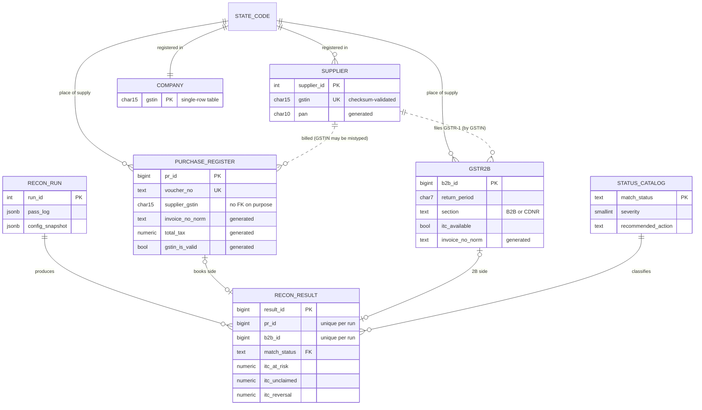
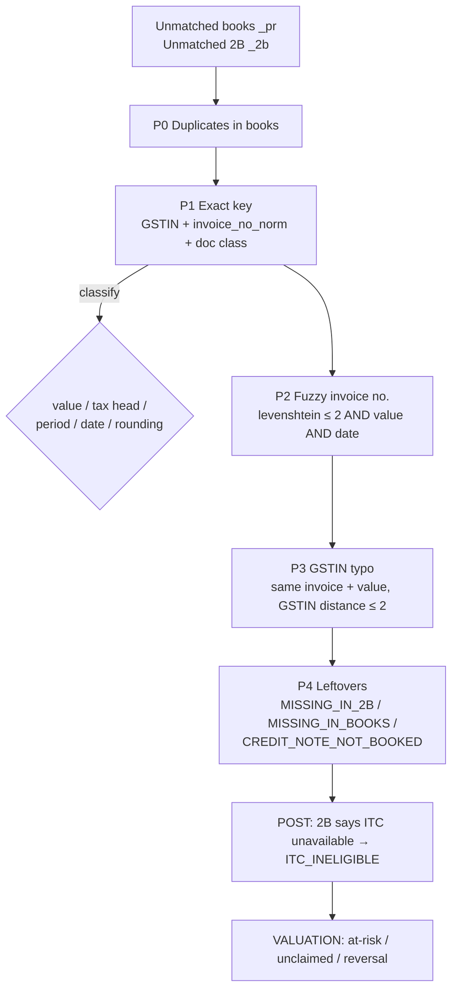

# Architecture & Data Model

*GST Reconciliation Engine, by Dharmesh Kumar*

## 1. Layers

| Schema | Role | Trust level |
|---|---|---|
| `stg` | Raw CSV landing tables (every column is `TEXT`) and `load_rejects` | untrusted |
| `gst` | Validated core model, engine, run audit, reporting views | trusted |
| `qa`  | Ground-truth labels, accuracy view, assertion helper | test only |

## 2. Entity-relationship diagram

Dotted lines are logical relationships that are deliberately **not** enforced with foreign keys: the books contain mistyped GSTINs, and the engine has to reconcile them rather than reject them.

## 3. Engine flow

After each pass, matched records are deleted from the temporary working sets, so later (looser) passes can never steal a record that a stricter pass already paired.

## 4. Status catalogue

| Status | Group | Severity | Rupee bucket |
|---|---|---|---|
| MATCHED | MATCHED | 0 | none |
| MATCHED_TOLERANCE | MATCHED | 0 | none |
| MATCHED_DATE_DIFF | MATCHED | 1 | none |
| MATCHED_FUZZY_INVNO | MATCHED | 1 | none |
| MATCHED_GSTIN_CORRECTION | MATCHED | 2 | none |
| MATCHED_CROSS_PERIOD | TIMING | 1 | none |
| MISMATCH_VALUE | MISMATCH | 2 | at risk (books > 2B) or unclaimed (2B > books) |
| MISMATCH_TAX_HEAD | MISMATCH | 3 | at risk |
| MISSING_IN_2B | MISSING | 3 | at risk |
| MISSING_IN_BOOKS | MISSING | 1 | unclaimed |
| CREDIT_NOTE_NOT_BOOKED | MISSING | 2 | reversal |
| DUPLICATE_IN_BOOKS | COMPLIANCE | 3 | reversal |
| ITC_INELIGIBLE | COMPLIANCE | 3 | at risk |

## 5. Synthetic data design

`data_generator/generate_data.py` (standard library only, seed 42):

- **120 suppliers** across 11 states, with Pareto-distributed purchase volume and reliability tiers A/B/C. Tier-C suppliers are about 16× more likely to skip filing.
- **Valid GSTINs** with real Luhn mod-36 checksums, built from random PAN-format strings.
- **Five invoice-number styles** (`INV/25-26/0012`, `SI-00012`, `KA000012`, `0012/25-26`, `GST/12`).
- **Lognormal invoice values**, which follow Benford's law (confirmed by Q4).
- **Two-phase generation:** every supplier's full invoice series is issued first, then typos are planted, so a typo can never collide with a real invoice number issued later in the year.
- Every record gets a **ground-truth label**, which is how the engine is graded.
