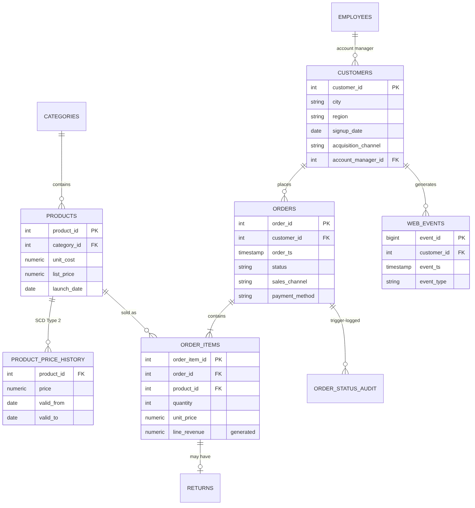
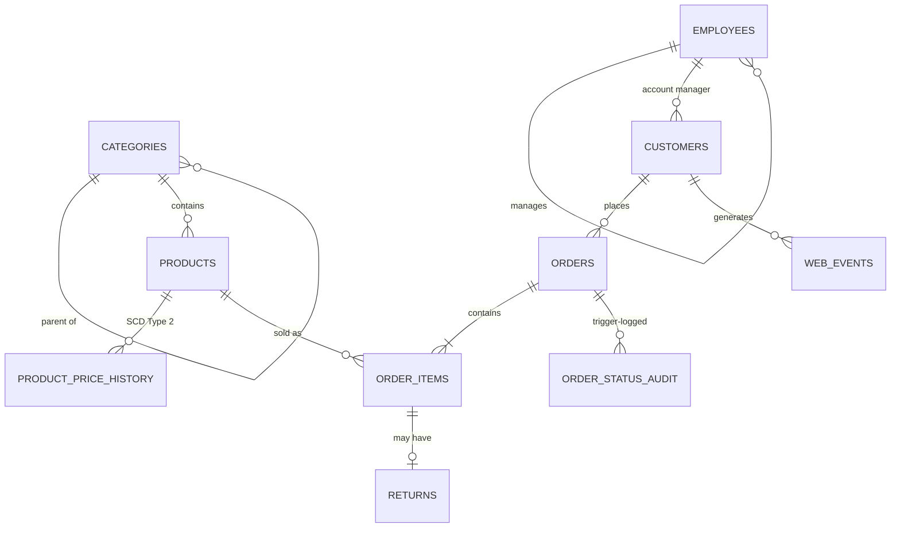

# 🛒 RetailPulse — Advanced SQL Analytics Project


An end-to-end **PostgreSQL** analytics project for a fictional Indian multi-channel e-commerce retailer (Web, App, Store · 15 cities · 2023–2025).
It goes from **schema design → synthetic data generation → reusable database objects → 30+ business-analysis queries → query optimisation**, all in pure SQL.

> **Headline:** ₹43.9 Cr in recognised revenue across 14.8k orders. 2025 revenue was **+40% YoY**, and the Diwali window runs at **~2.1× normal daily sales**. The top 20% of customers drive **59%** of revenue.

---

## 📐 Data model



<details><summary>Mermaid version (includes self-referencing relationships)</summary>



</details>

| Table | Rows | Notes |
|---|---|---|
| `customers` | 5,000 | city, region, acquisition channel, account manager |
| `products` | 126 | 14 sub-categories under 5 parent categories |
| `product_price_history` | 186 | **SCD Type 2** (valid_from / valid_to) |
| `employees` | 19 | 4-level org chart (self-referencing) |
| `orders` / `order_items` | 16.5k / 32k | `line_revenue` is a **stored generated column** |
| `returns` | ~1.4k | validated by trigger |
| `web_events` | ~200k | raw clickstream **without session ids** (sessionised in SQL) |

The data is generated **entirely in SQL** (`generate_series` + seeded `random()`), so it's reproducible. It has realistic behaviour built in: business growth, Diwali seasonality, churn decay, Pareto spend, accessory cross-sell, and a price rise applied to only half the catalogue (a natural experiment).

---

## 📁 Project structure

```
retailpulse-sql/
├── run_all.sh                     # builds DB + runs every analysis -> results/
├── docker-compose.yml             # one-command Postgres with data preloaded
├── .github/workflows/sql-tests.yml# CI: runs every query on each push
├── docs/er_diagram.png
├── sql/
│   ├── 01_schema.sql              # DDL: PK/FK, CHECKs, generated column, self-refs
│   ├── 02_seed_data.sql           # reproducible synthetic data
│   ├── 03_views_functions.sql     # views, materialized view, functions, procedure, triggers
│   ├── 04_indexes.sql             # FK, partial, covering (INCLUDE), expression indexes
│   └── analysis/
│       ├── 01_sales_performance.sql
│       ├── 02_customer_analytics.sql
│       ├── 03_product_analytics.sql
│       ├── 04_funnel_sessions.sql
│       ├── 05_advanced_patterns.sql
│       └── 06_query_optimization.sql
└── results/                       # captured output of every query
```

## ▶️ How to run

**Option A: Docker (no install needed)**
```bash
git clone https://github.com/Dharmeshkumar2327/retailpulse-sql.git && cd retailpulse-sql
docker compose up -d                       # Postgres 16 with all data loaded
docker exec -i retailpulse-db psql -U postgres -d retailpulse < sql/analysis/02_customer_analytics.sql
```

**Option B: Local PostgreSQL 14+**
```bash
./run_all.sh                 # creates DB "retailpulse" (~1 min), writes results/*.txt
# or run files individually:
psql -d retailpulse -f sql/analysis/02_customer_analytics.sql
```

Set `PGHOST`, `PGUSER` and `PGPASSWORD` as needed. Everything lives in the `retail` schema.

Every push runs the full build and all queries in **GitHub Actions** (see the badge above).

---

## 🧠 Advanced SQL techniques covered

| Technique | Where |
|---|---|
| Window functions: `LAG`, running `SUM`, moving `AVG` with `ROWS` frames, `RANK`, `DENSE_RANK`, `NTILE`, `PERCENT_RANK`, `CUME_DIST`, `FIRST_VALUE`, named `WINDOW` | 01, 02, 03 |
| `ROLLUP`, `GROUPING SETS`, `GROUPING()` subtotal labels | 01-Q3, 04-Q1 |
| Pivoting with `FILTER (WHERE …)` (no crosstab extension) | 01-Q4, 02-Q2 |
| Date spines with `generate_series` (zero-fill missing days) | 01-Q2, 05-Q3 |
| **RFM segmentation** with `NTILE` scoring | 02-Q1 |
| **Cohort retention matrix** | 02-Q2 |
| Ordered-set aggregates: `PERCENTILE_CONT`, `MODE() WITHIN GROUP` | 02-Q3, 03-Q4, 05-Q5 |
| Personalised churn thresholds (per-customer gap baseline) | 02-Q4 |
| Pareto / cumulative share analysis | 02-Q5, 03-Q1 (ABC) |
| **Market-basket analysis** (support, confidence, lift) via self-join | 03-Q2 |
| `LATERAL` top-N-per-group | 03-Q3 |
| **Difference-in-differences** price-elasticity test on SCD2 data | 03-Q5 |
| **Sessionisation** (gaps-and-islands: `LAG` + running `SUM`) | 04-Q0 |
| Funnel conversion, `BOOL_OR`, cart abandonment | 04-Q1–Q3 |
| Consecutive-month streaks (gaps-and-islands, `ROW_NUMBER` trick) | 04-Q4 |
| **Recursive CTEs**: org chart with sub-tree revenue roll-up, category breadcrumbs | 05-Q1, Q2 |
| Statistical anomaly detection (rolling z-score) | 05-Q3 |
| As-of (point-in-time) join with `LATERAL … LIMIT 1` | 05-Q4 |
| Nested JSON output (`jsonb_build_object`, `jsonb_agg`) | 05-Q6 |
| Data-quality assertion suite (`NOT EXISTS`, `daterange &&`) | 05-Q7 |
| Views, **materialized view** with unique index for `REFRESH … CONCURRENTLY` | 03_views |
| SQL & PL/pgSQL **functions** (scalar + table-valued) | 03_views |
| **Stored procedure** with row locking (`FOR UPDATE`) and validation errors | 03_views |
| **Triggers**: audit log + business-rule enforcement | 03_views |
| Partial, covering (`INCLUDE`), composite and expression **indexes** | 04_indexes |
| `EXPLAIN ANALYZE` tuning: sargability, correlated subquery rewrite, index-only scans | 06 |

---

## 📊 Key findings

**Sales**
- Revenue grew from ₹4.2 Cr (2023) to ₹16.5 Cr (2024) to **₹23.1 Cr (2025, +40%)**, and gross margin rose from 16.0% to 19.3%.
- Diwali (10 Oct–19 Nov) runs at **2.0–2.9× normal daily revenue** every year.
- **South** is the largest region (₹8.2 Cr in 2025). **West (+49%)** and **East (+49%)** are growing fastest.
- Electronics brings in ~79% of revenue (high ticket size). Fashion and Beauty are high-margin but small.

**Customers**
- **Champions** (13% of buyers) generate **32%** of revenue. "Cannot Lose Them" (14% of buyers, 23% of revenue) haven't bought in about 14 months, so they are the top win-back target.
- Top 20% of customers drive 59% of revenue, a classic Pareto pattern.
- 34% of buyers return within 30 days, but **27% never place a second order**. The first 30 days are the retention window that matters.
- Acquisition channels produce similar LTV (median ₹62k–68k). Social and Referral lead slightly.

**Products**
- **ABC:** 18 products (14% of the catalogue) earn 79% of revenue.
- **Cross-sell:** Audio and Accessories are bought with Laptops and Mobiles at **lift 1.5–1.6**. This supports "frequently bought together" bundles.
- **Price test:** products with a 9% price rise grew **6 pp slower** than the control group. Demand is fairly inelastic, so the rise paid off.

**Digital funnel**
- Session conversion is 15.3%. **Mobile converts at 13.3% vs Desktop at 17.6%**, losing most at view→cart and cart→checkout. This is the clearest UX opportunity.
- Cart abandonment has risen through 2025: lapsed customers keep browsing without buying. Retargeting is the lever here.

**Performance**
- Rewriting a correlated subquery as a window function: **128 ms → 8 ms (16×)**.
- A sargable range predicate replaces a Seq Scan with an Index-Only Scan.
- The materialized view serves the monthly KPI dashboard in **0.03 ms instead of 40 ms**.

## 💡 Recommendations
1. Launch a win-back campaign for "Cannot Lose Them" and "At Risk" customers, routed through their account managers (churn list in 02-Q4).
2. Add a 30-day post-purchase nurture flow to convert one-time buyers.
3. Bundle accessories with phones and laptops at checkout.
4. Prioritise mobile checkout UX fixes.
5. Stock up A-class SKUs before Diwali.

---

## 🔧 Extending the project
- Hook `mv_monthly_kpis` up to Power BI or Tableau as a live dashboard source.
- Schedule `REFRESH MATERIALIZED VIEW CONCURRENTLY` with `pg_cron`.
- Partition `web_events` by month (`PARTITION BY RANGE (event_ts)`).
- Port the analysis layer to dbt models with the data-quality checks as tests.

---

**Author:** Dharmesh Kumar · [GitHub](https://github.com/Dharmeshkumar2327) · [LinkedIn](https://www.linkedin.com/in/dharmesh-kumar-293a89235)

*All data is synthetic and generated for learning and portfolio purposes.*
